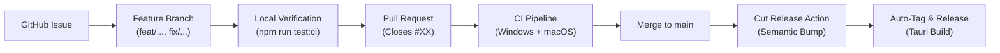
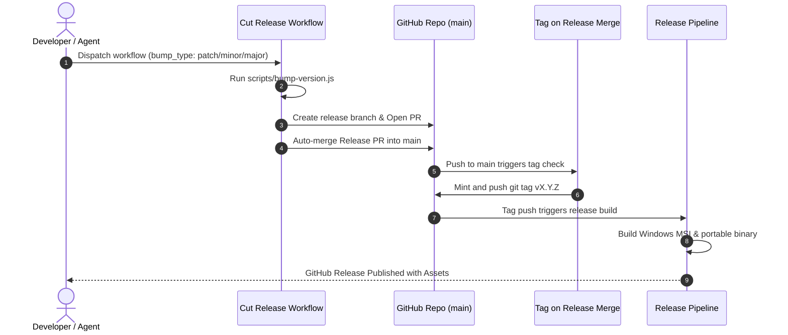

# Development Workflow 🛠️

This document outlines the standard end-to-end development workflow for **FocusHUD**. It is designed to guide both human developers and AI pair-programming agents from ideation to release.

---

## 1. Overview & Philosophy

FocusHUD follows a trunk-based development workflow:
- `main` is always stable and releasable.
- All changes originate from short-lived feature or fix branches.
- Every pull request must pass the automated CI matrix before merging.
- Releases are automated through GitHub Actions using Semantic Versioning.



---

## 2. Issue Lifecycle

### Creating an Issue
Before writing code, ensure a corresponding GitHub Issue exists:
1. **Title:** Clear and imperative (e.g., `Add mini rail pause shortcut`, `Fix work area glitch on dual displays`).
2. **Context:** Describe the problem, user story, or desired capability.
3. **Acceptance Criteria:** A checklist of expected behavior.
4. **Labels:** Apply relevant labels (`enhancement`, `bug`, `documentation`, `ci`).

### Picking the Next Issue
1. Review open issues prioritized under the current active milestone.
2. Assign yourself (or your agent session) to the issue to signal in-flight work.
3. Note the issue number `#<ID>` for branch naming and PR linking.

---

## 3. Branching Strategy

Always branch from the latest state of `main`:

```bash
git checkout main
git pull origin main
git checkout -b <branch-type>/<issue-id>-<short-description>
```

### Branch Naming Conventions
Use prefixes that describe the intent of the change:
- `feat/<id>-<slug>`: New user-facing feature or HUD component.
- `fix/<id>-<slug>`: Bug fix in frontend or Rust backend.
- `ci/<id>-<slug>`: Updates to GitHub Actions workflows or scripts.
- `docs/<id>-<slug>`: Documentation, guides, or `.drawio` architecture diagrams.
- `refactor/<id>-<slug>`: Code restructuring without feature or bug changes.

*Example:* `feat/101-browser-button-state-machine`

---

## 4. Development & Local Verification

FocusHUD is a hybrid **React 19 + TypeScript** frontend with a **Tauri v2 + Rust** backend. Both parts of the stack must pass verification before committing.

### Local Dev Servers
- **Fast Web UI preview:**
  ```bash
  npm run dev
  ```
- **Full native Tauri desktop app:**
  ```bash
  npm run tauri dev
  ```

### Verification Gate
Before committing, run the unified verification suite:
```bash
npm run test:ci
```

This runs:
1. `npm run typecheck` (`tsc --noEmit`)
2. `npm test` (Vitest unit tests)
3. `cargo fmt --check --manifest-path src-tauri/Cargo.toml` (Rust formatting)
4. `cargo clippy --manifest-path src-tauri/Cargo.toml -- -D warnings` (Rust lints)
5. `cargo test --manifest-path src-tauri/Cargo.toml` (Rust unit tests)

> [!TIP]
> A Git pre-commit hook is configured via `simple-git-hooks` to run `typecheck` and frontend unit tests automatically on every commit.

---

## 5. Commit Standards

We enforce [Conventional Commits](https://www.conventionalcommits.org/):

```
<type>(<optional scope>): <imperative description>
```

### Common Types:
- `feat:` A new feature.
- `fix:` A bug fix.
- `docs:` Documentation or diagram changes (`.md`, `.drawio`).
- `test:` Adding or updating tests.
- `ci:` Changes to GitHub Actions or release scripts.
- `refactor:` Code change that neither fixes a bug nor adds a feature.
- `chore:` Maintenance tasks, dependency bumps, or release version updates.

*Examples:*
- `feat(timer): add keyboard accelerator for timer cancel`
- `fix(dock): prevent webview clipping during stationary drag`
- `docs(diagrams): add browser button state machine drawio diagram`

---

## 6. Pull Requests & Code Review

1. **Push your branch:**
   ```bash
   git push -u origin <branch-type>/<issue-id>-<short-description>
   ```
2. **Open Pull Request against `main`:**
   - **Title:** Match conventional commit format (e.g., `feat(timer): dynamic button state machine`).
   - **Description:** Include what changed, testing notes, and explicitly link the issue:
     ```markdown
     ## Summary
     - Implements dynamic START/PAUSE/CANCEL transitions in the timer panel.
     - Adds state machine documentation diagram.

     Closes #101
     ```
3. **CI Status Check:**
   - The `.github/workflows/ci.yml` pipeline runs automatically on Windows and macOS runners.
   - All frontend and backend jobs must turn green.
4. **Merge:**
   - Review and merge into `main`. The `Closes #101` keyword will automatically close the linked issue.

---

## 7. Release Process & Automation

FocusHUD uses automated release pipelines powered by Semantic Versioning (SemVer: `MAJOR.MINOR.PATCH`).

### When to Cut a Release
- **`patch` (e.g., `0.3.8` -> `0.3.9`):** Bug fixes, performance improvements, minor styling tweaks, or internal refactors.
- **`minor` (e.g., `0.3.x` -> `0.4.0`):** New HUD widgets, new telemetry metrics, significant features, or UX additions.
- **`major` (e.g., `0.x.x` -> `1.0.0`):** Breaking architectural changes, major UI overhaul, or general public release readiness.

### Triggering a Release (Recommended Automated Path)
FocusHUD has a one-click release automation workflow:
1. Navigate to **Actions** > **Cut Release** in GitHub.
2. Click **Run workflow**.
3. Select the version bump level: `patch`, `minor`, or `major`.
4. Click **Run workflow**.



### Manual / Local Release Bump (Fallback)
If cutting a release manually from your terminal:
```bash
# 1. Ensure you are on a clean main branch
git checkout main
git pull origin main

# 2. Run the bump script (runs full CI gate and updates version across package.json, tauri.conf.json, and Cargo.toml)
npm run bump:patch   # or npm run bump:minor / npm run bump:major

# 3. Push the release commit or PR
git push origin main
```
The merge/push will trigger `tag-on-release-merge.yml`, which mints the tag and executes `release.yml`.

